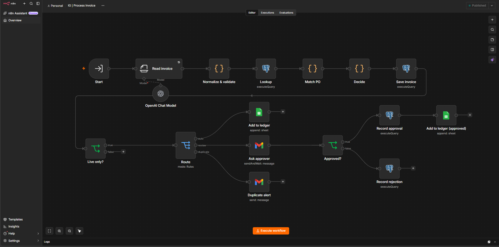
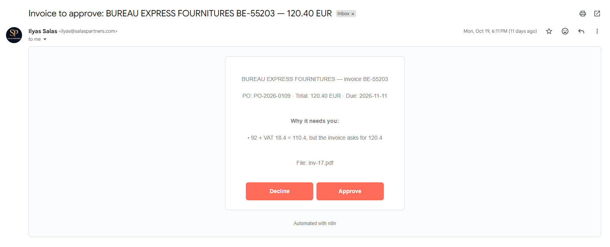
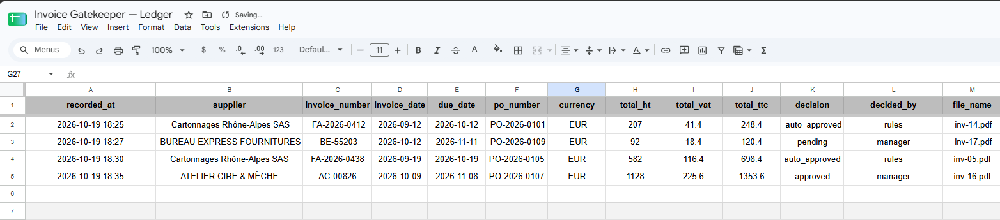

# Invoice Gatekeeper (demo project)

An AI accounts-payable workflow built with **n8n**, **OpenAI** and **PostgreSQL**.
Supplier invoices arrive by email. AI reads each PDF; plain rules then check it against the company's
purchase orders before anyone pays it. Clean invoices go straight to the ledger. Anything else goes to
a human with the reasons, as an Approve / Reject email.

> **Demo project.** The company ("Maison Lumen"), its suppliers and all 20 invoices are fictional,
> generated for testing. Every PDF says so in its footer.

## What it checks

| Check | Example |
|---|---|
| Duplicate | The same supplier invoice sent twice (a reminder) |
| Price above the PO | Billed €34.90 each, agreed €32.00 |
| Quantity above the PO | 120 billed, 100 ordered |
| Totals that don't add up | Total before VAT + VAT ≠ total to pay |
| Unknown supplier | Not in the supplier list |
| No purchase order | No PO reference, or a PO that doesn't exist |
| Approval limit | Above €1,500, a manager signs, even when everything is clean |

The AI only **reads** (structured output with a fixed JSON schema). Every decision is made by code and
SQL, so it is predictable and auditable.

## How it works

```
Gmail (invoices address) ─┐
                          ├─► IG | Intake ─► Split PDFs ─► Extract text ─► IG | Process invoice (once per file)
Upload form (live / eval) ┘

IG | Process invoice:
  Read invoice (AI) ─► Normalize & validate (code) ─► Lookup (SQL) ─► Match PO (code) ─► Decide (code) ─► Save invoice (SQL)
     ├─ auto_approved ─► Ledger (Google Sheets)
     ├─ needs_review  ─► Approve / Reject email ─► record the decision ─► Ledger if approved
     └─ duplicate     ─► alert email, nothing recorded for payment

IG | Error alerts: any failure ─► email with the workflow, node and error
```

## Results

Measured on the 20 test invoices in evaluation mode (30 October 2026). Details: [`docs/evaluation.md`](docs/evaluation.md).

| Measure | Result |
|---|---|
| Fields read exactly right (7 fields) | 100% |
| Invoices routed correctly | 20/20 |
| Planted problems caught | 7/7 |
| False alarms | 0 |
| OpenAI cost | about $0.001 per invoice |
| Processing time | about 3 seconds per invoice |

Test set: synthetic, digital PDFs. Real invoices are messier, so these numbers are a baseline, not a promise.

### Screenshots

**The processing workflow in n8n**


**An invoice billed above the agreed price waits for a manager**


**Clean and approved invoices land in the ledger**


## What's in this repo

| Folder | Contents |
|---|---|
| `invoices/` | 20 test invoices (PDF), French and English, 3 layouts, 7 with a planted problem |
| `testdata/` | `ground_truth.csv` (the answer key), pin data for testing the workflow in the editor |
| `sql/` | `seed.sql` (schema + demo data), the workflow's 3 queries, the evaluation and weekly-report queries |
| `code/` | The JavaScript of the n8n Code nodes |
| `prompts/` | The extraction JSON schema and system prompt |
| `docs/` | Evaluation write-up and screenshots |
| `workflows/` | n8n workflow exports (IG \| Intake, IG \| Process invoice, IG \| Error alerts) |

## Run it yourself

1. Self-hosted n8n with PostgreSQL (this project runs on n8n 2.40.7 on a VPS with Docker Compose: Caddy, n8n, Postgres 16).
2. Load the database: `psql -U <user> -d <db> < sql/seed.sql`
3. Import the workflows from `workflows/`, then connect your own OpenAI, Postgres, Gmail and Google Sheets credentials.
4. Upload the 20 PDFs through the form with **Mode = eval**, then run `sql/eval.sql`.

## Limitations (v1)

- Digital PDFs only. A scanned invoice (image only) has no text, so it goes to human review.
- One VAT rate per invoice is checked; French rates are in a list in the code.
- The PO check is per invoice (quantity on this invoice vs ordered), not cumulative across invoices.
- The approval limit compares the number in the invoice currency, with no conversion.
- In France, VAT-registered companies must be able to receive structured e-invoices since 1 September 2026
  (issuing becomes mandatory for SMEs on 1 September 2027). The checks and approvals here apply to those too;
  only the reading step would change (parse the XML instead of reading a PDF).
