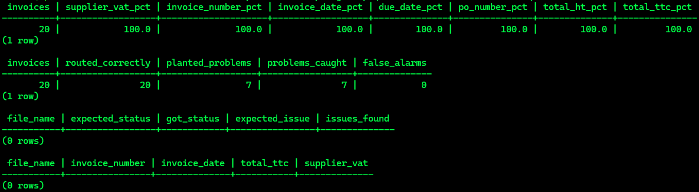

# Evaluation

Test set: 20 synthetic supplier invoices (16 in French, 4 in English, 3 layouts), 7 of them with a planted problem.
Answer key: `testdata/ground_truth.csv`. Queries: `sql/eval.sql`.

Only numbers I measured are written here.

## Run details

- Date of the run: 30 October 2026
- n8n version: 2.40.7 (self-hosted)
- Model used to read the invoices: gpt-4.1-mini (OpenAI)
- What I changed since the previous run: first full run, nothing changed

## Reading accuracy (query 1)

| Field | % exactly right |
|---|---|
| Supplier VAT number | 100% |
| Invoice number | 100% |
| Invoice date | 100% |
| Due date | 100% |
| PO number | 100% |
| Total before VAT | 100% |
| Total to pay | 100% |

## Decisions (query 2)

| Measure | Result |
|---|---|
| Invoices routed correctly | 20/20 |
| Planted problems caught | 7/7 |
| False alarms (clean invoice sent to review) | 0 |

## Mistakes and fixes (queries 3 and 4)

None on this run: both queries returned 0 rows.

## Cost and speed

- OpenAI cost for the run: about $0.02 for the 20 invoices (the usage page rounds to the cent), so about $0.001 per invoice.
- Speed: the 20 invoices went through in 58 seconds in total, processed one by one, so about 3 seconds per invoice (reading, checks and saving).

## Honest limits

- Synthetic invoices: real ones are messier (scans, photos, multi-page, mixed VAT rates). A perfect score on 20 clean digital PDFs does not mean 100% on real invoices.
- v1 reads digital PDFs only. A scanned invoice has no text and goes to human review.
- 20 invoices is a small test set. The next step would be a larger, messier set and a second run after each prompt change.
